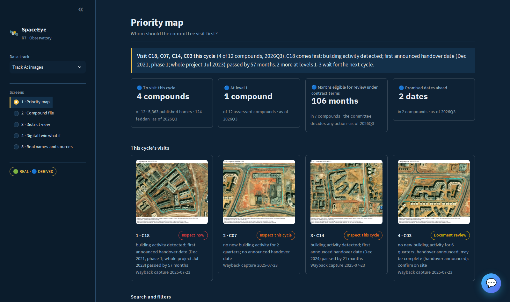
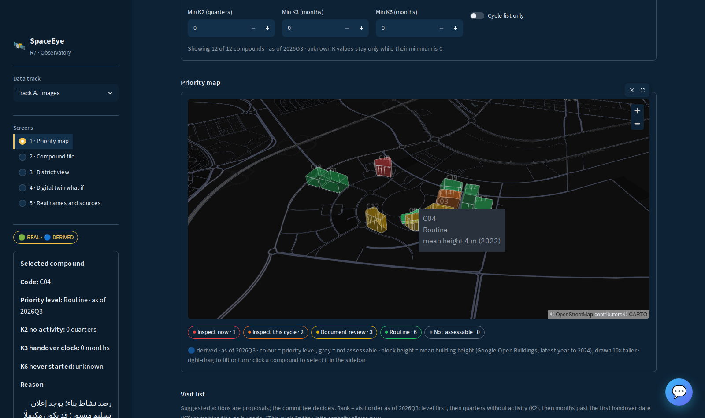
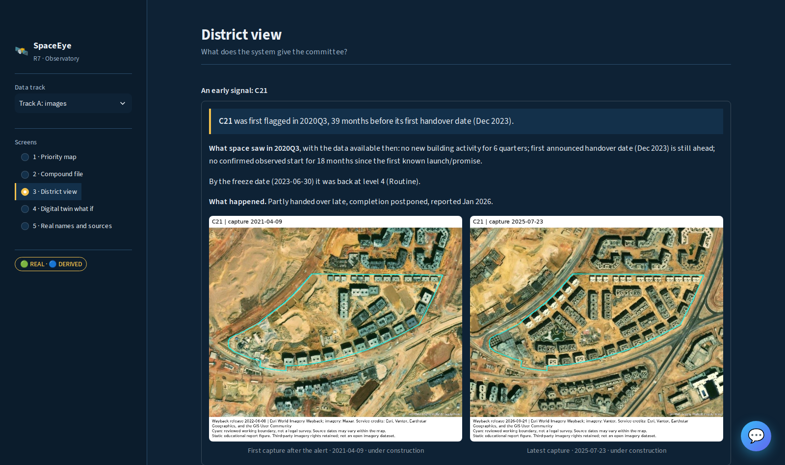

# SpaceEye: R7 inspection priority observatory

رادار العاصمة الجديدة: شركة تمتلك مدينة.
*(New Capital radar: a company that owns a city.)*

<p align="center">
  
  &nbsp; &nbsp;
  
</p>

<figure align="center">
  
  <figcaption>District view: the C21 early signal from the frozen-clock backtest, and when the rule fails.</figcaption>
</figure>

## Table of Contents

- [Overview](#overview)
- [Key Features](#key-features)
- [Setup](#setup)
  - [0. Prerequisites](#0-prerequisites)
  - [1. Clone the Repository](#1-clone-the-repository)
  - [2. Create Environment](#2-create-environment)
  - [3. Environment Variables](#3-environment-variables)
  - [4. Usage](#4-usage)
- [Deliverables](#deliverables)
- [Project Structure](#project-structure)
- [Contributing](#contributing)
- [Authors](#authors)

## Overview

- **Problem.** The chairman of ACUD stated publicly that there are more than 500 developers and more than 600 projects, and that field review happens every 3 months ([presentation](docs/deliverables/01-presentation/presentation.md)). A committee cannot visit everything, so which compounds should it visit first?
- **Goal.** Rank the 12 coded R7 compounds so the inspection committee can visit up to 4 per cycle, each with a reason. The committee decides.
- **Solution / aha.** Free public satellite data each quarter plus published developer statements feed three clocks, K2, K3 and K6. The worst signal sets the level; there are no weights. A Streamlit dashboard and a hybrid RAG chatbot present the list.
- **Results.** Honest reading: in the frozen-clock backtest of six real check cases, 1 of 6 is detected under the after-start reading and 0 of 6 point-in-time; the target of 5 was fixed before computing and was not met ([backtest](data/BACKTEST_CURRENT.md)). On Track B generated data (**Synthetic - for training only**), recall@4 on the time test ranges from 0.250 to 1.000 across six methods against a random mean of 0.335, with only 4 distressed rows in the test, so statistical power is very low ([report](data/EW_REPORT_CURRENT.md)). The value is 0.007 to 0.102 million EGP per year under stated assumptions; it is not a measured saving ([decision memo](docs/deliverables/decision-memo.md)).

### Current scope

| Item | Current state |
| --- | --- |
| Geography | 12 coded R7 compounds; R8 excluded |
| Public real-case check | Six cases; one detected under the after-start reading, zero at the frozen cutoff; the target of five cases was not met |
| Operational capacity | Four eligible inspections; comparisons at two/four/six |
| Training export | 180 compound-quarter rows, 40 declared features |
| Classifier | distressed / not_distressed in the next six months; completion is not predicted |
| Evaluation | 96 primary training rows, 48 time-test rows, fixed parameters and a separate chronological developer holdout |
| Heights | Available OBT observations through 2023 and approved 2024 estimate; contextual, without a fixed error guarantee |

Use [the current report](data/EW_REPORT_CURRENT.md) for method-specific counts and random comparison. Synthetic repeated-quarter results do not establish real-world accuracy. Published statements, derived indicators and generated assumptions have separate origins. Generated outputs retain **Synthetic - for training only**. No real compound or developer name is published.

**Observed imagery:** [view/rebuild guide](data/imagery/README.md), [source comparison](data/IMAGERY_COMPARISON.md) and [frame metadata](data/imagery/wayback_timeline.csv). The 100 Wayback / 528 Sentinel figures stay outside Git; the numerical v7 release is separate.

## Key Features

- **Dashboard** ([app.py](app.py)): five screens, a track switch, code search and filters, a map click with a details panel, the `ops_visits` form, and a cycle-list CSV export. Screens and forms are in the [user guide](docs/deliverables/user-guide.md).
- **Hybrid RAG chatbot** ([chatbot/](chatbot/), the project's only chatbot, opened by the dashboard's floating button): 10 intents, DuckDB facts plus Chroma vector search, Gemini within the approved 200-call budget ([configs/ai.yaml](configs/ai.yaml)) and local answers otherwise, and 9 sourced documents ([chatbot/knowledge](chatbot/knowledge/SOURCES.csv)).
- **Track A rule and indicators.** A is the derived building-activity score. K2 counts inactivity after the legacy start state; K3 measures elapsed months after the first available announced deadline; K4 records assessability. K6 measures time from a known launch/promise reference without confirmed observed start and remains unknown when evidence is insufficient. K5 is screening exposure, not verified contractual fine eligibility. The rule uses the worst applicable K2/K3/K6 signal, assessability and the may-be-complete cap. Selection uses eligible levels 1-3, then level, descending K2/K3 and code. Project thresholds live in [configs/data.yaml](configs/data.yaml). See the [implemented specification](data/IMPLEMENTED_DATA_SPEC.md).
- **Track B generated what-if** (S1/S2/S3). Illustrative monetary fines and financial/priority what-if outputs are generated assumptions, not actual assessments or forecasts. See the [scenario contract](data/SCENARIO_CONTRACT_CURRENT.md).
- **Quality gates and the v7 prepared release**, codes only. The package supplies Arabic committee lists, complaint-training corpora, 180 inspection contexts, synthetic visit exercises, current binary predictions and the S1/S2/S3 handoff. Contexts are not finished inspection reports; synthetic visits are not fieldwork. Raw inputs, private name mappings/truth, credentials and checkpoints are excluded.

## Setup

### 0. Prerequisites

- [uv](https://docs.astral.sh/uv/) and Git.
- Python `>=3.12` (`requires-python` in [pyproject.toml](pyproject.toml)); uv installs it if needed.
- Windows (PowerShell) or Linux/WSL.
- The prepared v7 data, which `setup_review` installs (step 2).

### 1. Clone the Repository

```bash
git clone https://github.com/elsayedelmandoh/spaceeye-geoai.git
cd spaceeye-geoai
```

### 2. Create Environment

```bash
uv sync --locked                     # add --extra chatbot for the chatbot
uv run --locked python -m src.pipeline.setup_review
```

On Linux the chatbot uses CPU-only torch from the PyTorch CPU index (set in `pyproject.toml`). Paths are checkout-relative; `SPACEEYE_DATA_ROOT` relocates the workspace without requiring a specific drive. Full steps for a new device or review: [REVIEW_SETUP](docs/REVIEW_SETUP.md). The [84-file source manifest](data/REBUILD_INPUTS.csv) and source-cache tool cover full rebuilds.

### 3. Environment Variables

Copy `.env.example` to `.env` in the repository root. `.env` is git-ignored: never commit it. `start.sh` / `start.ps1` create it on the first run and stop so you can add the Gemini key (ask the team lead).

| Variable | Meaning |
| --- | --- |
| `GEMINI_API_KEY` | Gemini key for the chatbot; only in `.env` |
| `GEMINI_MODEL` | Optional; overrides the model set in [configs/ai.yaml](configs/ai.yaml) |
| `MASK_SALT` | Salt for masking text before models/providers; set a random value outside development |
| `SPACEEYE_DATA_ROOT` | Moves the shared workspace root |
| `SPACEYE_DB_PATH` | Path to `spaceeye_ready.duckdb` from the unpacked v7 release (name as spelled in the code) |
| `CHATBOT_HOST` / `CHATBOT_PORT` | Chatbot bind address; default `127.0.0.1:8001` |

### 4. Usage

**One command.** Linux/WSL: `./start.sh`. Windows: `powershell -ExecutionPolicy Bypass -File .\start.ps1`. Both scripts check that uv is installed, create `.env` on the first run (and stop for the key), run `uv sync --locked --extra chatbot`, install the prepared data once, seed the chatbot search index from `chatbot/vector_db_seed`, start the chatbot on port 8001 and the dashboard on port 8501 (http://localhost:8501; the chat button is at the bottom right). On Linux the chatbot runs in the background (log in `chatbot/chatbot.log`) and stops with the dashboard; on Windows it opens in its own window. The first chatbot question downloads its embedding model, so it is slow once.

**By hand**, from the repository root:

```bash
# dashboard
uv run --locked streamlit run app.py

# chatbot (separate app behind the dashboard's floating chat button)
uv sync --locked --extra chatbot
uv run --locked --extra chatbot uvicorn chatbot.app.api.main:app --port 8001

# rebuild the chatbot index (git-ignored chatbot/vector_db/, upsert only)
uv run --locked --extra chatbot python -m chatbot.app.retrieval.build_index   # add --knowledge-only for the knowledge documents only

# rebuild from configured local inputs (cached workflow)
uv run --locked --offline python -m src.pipeline.team_run

# tests
uv run --locked --offline pytest -q
```

- Model calls follow `chatbot.approval` and `chatbot.max_calls_total` in [configs/ai.yaml](configs/ai.yaml) (approved by the project owner on 2026-11-04, 200 calls; the counter is `chatbot/vector_db/gemini_calls.json`). When unapproved or used up, the chatbot answers from its local path.
- `team_run` prepares cached data and fits current small binary diagnostics. It requires the external inputs/private evaluation data configured in [configs/data.yaml](configs/data.yaml); the ready ZIP alone is enough for reading and interface development, not for source rebuilding.
- `python -m src.pipeline.team_run --full` additionally fits/rebuilds Track A. With Make installed: `make data` is data-only, `make current` is the cached current workflow, and `make run` includes full Track A fitting. Do not refit models for documentation-only work.
- The historical early_warning/release modules remain for saved experiment audits and shared dependencies; they are not the current entrypoint. Operations and monitoring: [technical-track-a](docs/deliverables/technical-track-a.md).
- Using the ready data: extract the v7 ZIP and open its README.md; use CSV, Parquet or `spaceeye_ready.duckdb`, and run `verify_package.py` to check the file manifest. Only the current ZIP is distributed in this checkout; earlier files remain in Git history and a local retirement backup.

## Deliverables

| Deliverable | Files |
| --- | --- |
| Presentation | [presentation.pptx](docs/deliverables/01-presentation/presentation.pptx), [presentation.pdf](docs/deliverables/01-presentation/presentation.pdf), [presentation.md](docs/deliverables/01-presentation/presentation.md), [speaker transcript](docs/deliverables/01-presentation/transcript.md), [rubric map](docs/deliverables/01-presentation/rubric-map.md), [palette](docs/deliverables/01-presentation/palette.md) |
| Intro video | [intro-ai-voice.mp4](docs/deliverables/02-video/intro-ai-voice.mp4), [intro.md](docs/deliverables/02-video/intro.md), [rebuild kit](docs/deliverables/02-video/make/README.md) |
| Proposal | [proposal.md](docs/deliverables/03-proposal/proposal.md), [proposal.pdf](docs/deliverables/03-proposal/proposal.pdf) |
| User guide | [user-guide.md](docs/deliverables/user-guide.md) |
| Decision memo | [decision-memo.md](docs/deliverables/decision-memo.md) |
| Technical Track A | [technical-track-a.md](docs/deliverables/technical-track-a.md) |
| Knowledge transfer | [knowledge-transfer.md](docs/deliverables/knowledge-transfer.md) |
| Method card (model card) | [method-card.md](docs/deliverables/method-card.md) |
| v7 data | [Download the v7 ZIP](releases/ready-data/SpaceEye_R7_READY_DATA_2026-10-31_v7.zip?raw=1), [Data guide](releases/ready-data/DATA_GUIDE.md), [v6 archive validation](data/READY_V6_VALIDATION.json) |
| Data contracts | [Handoff](data/HANDOFF.md), [dataset contract](data/DATASET_CONTRACT.md), [sources and generation](data/DATA_SOURCES_AND_GENERATION.md), [approved binary scope](data/BINARY_SCOPE_DECISION.md) |
| Specs and planning | [Product requirements](docs/requirements/01-specs.md), [task board and human reviews](docs/requirements/02-team-roles-and-tasks.md), [remaining work](docs/REMAINING_TEAM_TASKS.md) |

## Project Structure

See [docs/project-definition/08-structure.md](docs/project-definition/08-structure.md) for the full table.

```text
app.py              Streamlit dashboard (five screens, track switch, ops_visits form)
start.sh, start.ps1 One-command start for Linux/WSL and Windows
chatbot/            Hybrid RAG chatbot: FastAPI app, frontend, knowledge/ sources, vector_db_seed
configs/            data.yaml (paths, thresholds, scope, capacity), ai.yaml, synthetic_sources.json
data/               Data contracts, reports, imagery metadata, scoped evidence
docs/               requirements/, project-definition/, deliverables/, REVIEW_SETUP.md
evals/              Dashboard screenshots (results/), benchmarks
releases/           ready-data: current v7 ZIP, checksum and usage guides
src/
  pipeline/         Source preparation, Track A, audits, setup_review, team_run
  generator/        Generated reconstruction and forward financial cases
  analysis/         Current binary evaluation and shared feature helpers
  dashboard/        Dashboard helpers
  config/ evaluation/ inference/ models/ utils/
tests/              Regression and behavior checks
```

## Contributing

- Work only on feature branches and merge through PRs; never force-push and preserve teammates' work. Use the configured human Git identity.
- Run the tests (`uv run --locked --offline pytest -q`) and lint touched Python with Ruff before a PR.
- Use codes only (C.., D..): no compound or developer names. Generated outputs keep **Synthetic - for training only**.
- Never commit `.env`, raw data, private mappings/truth or checkpoints. Only the approved prepared ZIP is published.
- The [task board](docs/requirements/02-team-roles-and-tasks.md) is the single task list: a checked main task means implemented and ready for review; its separate review checkbox is ticked only after a recorded review. Keep evidence and [remaining work](docs/REMAINING_TEAM_TASKS.md) synchronized.

## Authors

- **elsayed elmandoh** - NLP / LLM Engineer
- **verina fouad** - Applied AI / Machine Learning Engineer
- **ahmed abdelhamid** - Generative AI Engineer
- **nada shady** - AI Engineer
- **salma magdy** - Data Scientist

[](https://www.linkedin.com/in/elsayed-elmandoh-b5849a1b8/)
[](https://www.linkedin.com/in/verina-fouad/)
[](https://www.linkedin.com/in/ahmed-abdelhameed-ai/)
[](https://www.linkedin.com/in/nadashady/)
[](https://www.linkedin.com/in/salma-magdy-ml/)
[](https://github.com/elsayedelmandoh/spaceeye-geoai)
