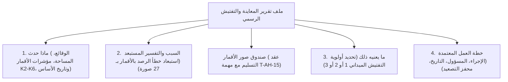

# Deterministic Inspection Template & Report Engine (T-VE-03)

> **المهمة:** `T-VE-03` [Must] · Inspection file template filled by code (what happened, why + rejected explanation, what it means, what we do) without LLM.  
> **تاريخ الاعتماد والتنفيذ:** 29 أكتوبر 2026.  
> **المسار:** `SpaceEye-GeoAI` · Track B / AI Component.

---

## 1. ملخص مخرجات المهمة (Core Deliverables)

| # | المخرج (Deliverable) | مسار الملف في الـ Repo | الوصف والوظيفة |
|---|---|---|---|
| **1** | **كود ماكينة توليد التقارير** | [`src/inference/inspection_template.py`](../../src/inference/inspection_template.py) | محرك كود كلاسيكي حتمي (Deterministic Engine) يولد ملفات التفتيش الرسمية كاملة دون أي اعتماد على الذكاء الاصطناعي لضمان العمل أوفلاين. |
| **2** | **ملف تقرير المعاينة الحقيقي** | [`app_data/files/C07_2026Q3_inspection.html`](../../app_data/files/C07_2026Q3_inspection.html) | ملف HTML رسمي باللغة العربية لكمبوند `C07` مجهز للطباعة A4 والحفظ كـ PDF. |
| **3** | **ملف التوثيق الرسمي للمهمة** | [`docs/deliverables/INSPECTION_TEMPLATE.md`](INSPECTION_TEMPLATE.md) | هذا الملف لتوثيق الهيكل الهندسي وعقد الـ Pipeline للجنة التحكيم ومطابقة الـ PR على GitHub. |

---

## 2. الهيكل الإلزامي للأقسام الأربعة (The 4 Mandatory Sections)

1. **القسم الأول: ماذا حدث (What happened):**
   * كود الكمبوند (`C07`) والمطور (`D07`) والحي (`R7`).
   * مساحة الأرض المعتمدة مساحياً (`96,619 م²`).
   * ركود البناء بالأقمار `K2` (أرباع سنوية متتالية بدون أي صب أو معدات).
   * أشهر التأخير عن موعد التسليم الأول `K3` والغرامات المستحقة `K5`.
   * إحصاء شكاوى المشترين المسجلة قبل تاريخ الأساس (`65 شكوى` موسومة بالمحاكاة).
2. **القسم الثاني: السبب والتحليل السببي بالأرقام (Why + Rejected alternative explanation):**
   * ذكر جملة سبب الأولوية المحسوبة من الأقمار الصناعية باللغة العربية.
   * دحض فرضية خطأ الرصد السحابي أو البصري استناداً إلى ثبات الرصد عبر **27 صورة قمر صناعي متتالية** خلال الربع.
   * استبعاد فرضية اكتمال المشروع الفعلي لعدم صدور شهادة صلاحية الإشغال المعتمدة (المادة 62 من قانون 119/2008).
3. **القسم الثالث: ما يعنيه ذلك (What it means):**
   * تحديد الأولوية الرقابية الصريحة (الأولوية 2 - تفتيش ميداني عاجل خلال أسبوعين).
4. **القسم الرابع: خطة العمل (What we do: Action, Owner, Due Date, Escalation):**
   * **الإجراء:** معاينة فنية وحصر هندسي شامل للأعمال المنفذة.
   * **المسؤول:** إدارة الرقابة والمتابعة الميدانية - مهندس القطاع R7.
   * **الموعد المستهدف:** خلال 14 يوماً من تاريخ صدور التقرير.
   * **محفز التصعيد:** في حال ثبوت التوقف دون عذر مقبول: إحالة الملف للشؤون القانونية وتفعيل غرامات القرار 2184.

---

## 3. تكامل خط الإنتاج وعقد التسليم (Hand-off Contract with T-AH-15)

* **السياسة المعتمدة:** تطبيق مبدأ الـ **Graceful Fallback**:
  * القالب يفحص مسار صور الأقمار الصناعية (قبل/بعد):
    * إذا تم تسليم الصور من مهمة الزميل أحمد (`T-AH-15`)، يتم عرضها تلقائياً مع تواريخ الالتقاط وجهة الاعتماد (Maxar / Wayback).
    * في حال عدم التسليم حتى تاريخه، يعرض القالب صندوقاً هندسياً شفافاً يوضح: *"حالة الصور: قيد التجهيز من مهمة T-AH-15 (حالة: missing_image) والالتزام الصارم بعدم اختلاق أي صور غير موثقة"*.
  * يضمن هذا العقد استقلالية محطة المعاينة والتفتيش وعدم تعطل الـ Pipeline في حال تأخر تسليم الصور.

---

## 4. التجهيز للطباعة الرسمية (Print-Ready A4 & PDF Styling)

تم تزويد كود الـ HTML بقواعد أنماط الطباعة المعيارية (`@media print`):
* ضبط أبعاد الصفحة تلقائياً على مقاس `A4` بهوامش معيارية.
* منع انقسام الجداول والصناديق بين الصفحات (`page-break-inside: avoid`).
* ترويسة وتذييل معتمد يحمل كود المشروع، وتاريخ الاستخراج، واسم المراجع المعتمد، وتاريخ الأساس الزمني.
