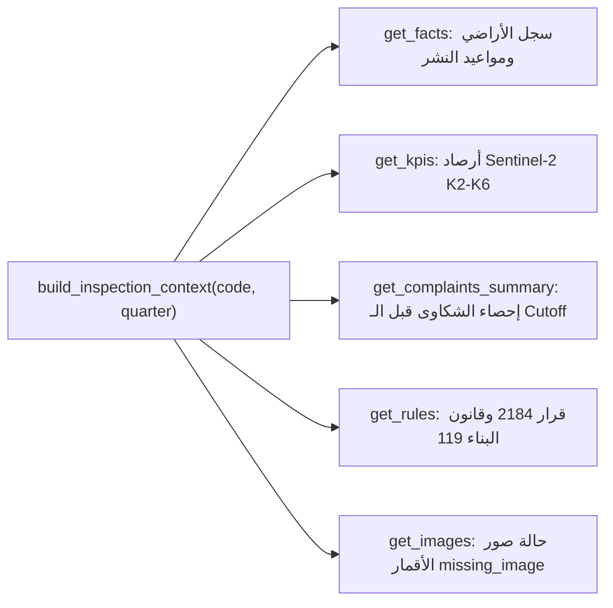

# Inspection Agent Plain Python Tools (T-VE-02)

> **المهمة:** `T-VE-02` [Must] · Agent tools as plain Python: `get_facts`, `get_kpis`, `get_images`, `get_rules` + unit tests.  
> **تاريخ الاعتماد والتنفيذ:** 29 أكتوبر 2026.  
> **المسار:** `SpaceEye-GeoAI` · Track B / AI Component.

---

## 1. ملخص مخرجات المهمة (Core Deliverables)

| # | المخرج (Deliverable) | مسار الملف في الـ Repo | الوصف والوظيفة |
|---|---|---|---|
| **1** | **كود الأدوات البرمجية** | [`src/inference/tools.py`](../../src/inference/tools.py) | دوال بايثون صريحة لجلب الحقائق والمؤشرات والصور والقرارات المنظمة دون تسريب زمني. |
| **2** | **وحدة الاختبارات الآلية (7 Tests)** | [`tests/test_inspection_tools.py`](../../tests/test_inspection_tools.py) | اختبارات Unit Tests شاملة تؤكد صحة استرجاع الأرقام ومطابقة السجلات وتأكيد عدم وجود تسريب للمعلومات. |
| **3** | **ملف التوثيق الرسمي للمهمة** | [`docs/deliverables/INSPECTION_TOOLS.md`](INSPECTION_TOOLS.md) | هذا الملف لتوثيق الدوال وآليات منع التسريب الزمني للجنة التحكيم ومطابقة الـ PR على GitHub. |

---

## 2. تفصيل دوال الأدوات المنفذة (Implemented Plain Python Tools)

### 1. `get_facts(code, as_of_quarter)`
* **الوظيفة:** تسترجع مساحة الأرض، المطور، الارتفاع المسموح، وعدد الوحدات من سجلات العاصمة الإدارية المعتمدة.
* **الحماية من التسريب الزمني (Lookahead Bias Prevention):**
  * لا يتم عرض موعد التسليم التعاقدي `first_deadline` إلا إذا كان تاريخ نشره الرسمي `first_deadline_published` سابقاً أو مساوياً لتاريخ نهاية ربع التفتيش (`cutoff_date`).
  * يتم فلترة الإعلانات المنشورة `statements.csv` بحيث لا تظهر أي إعلانات نُشرت بعد تاريخ الـ Cutoff.

### 2. `get_kpis(code, as_of_quarter)`
* **الوظيفة:** تسترجع أرقام الأقمار الصناعية الفعلية من مسار Track A:
  * ركود البناء `K2` (أرباع سنوية متتالية).
  * تأخير التسليم `K3` (أشهر).
  * كفاية الصور `K4` وشهور الغرامات المستحقة `K5`.
  * مستوى الأولوية (Level 1 / 2 / 3 / 4) وجملة السبب باللغة العربية (`reason_ar`).
  * التاريخ الزمني لأحدث 4 أرباع للمشروع.

### 3. `get_complaints_summary(code, as_of_quarter)`
* **الوظيفة:** تسترجع عدد شكاوى المشترين المسجلة للكمبوند حتى تاريخ الـ Cutoff فقط، مع إرجاع عينة من آخر 3 شكاوى مموهة والتوثيق الصريح بأنها *"بيانات محاكاة للتدريب فقط"*.

### 4. `get_images(code)`
* **الوظيفة:** الالتزام الصارم بشروط المشروع؛ ترجع حالة صريحة `missing_image` وتوثق أن صور الأقمار من Maxar/Wayback قيد التسليم من المهمة `T-AH-15` دون أي اختلاق لصور غير موثقة.

### 5. `get_rules(article_id=None)`
* **الوظيفة:** استرجاع نصوص المواد والقرارات الوزارية:
  * قرار رئيس مجلس الوزراء 2184 (المواد 3، 4، 5) لحسابات الضمان وفترات السماح وغرامات التأخير.
  * قانون البناء 119 لسنة 2008 (شهادات الإشغال وتراخيص البناء).
  * اشتراطات العاصمة الإدارية ACUD (النسبة البنائية 22.5% وأرضي + 7 أدوار).

---

## 3. نتائج الاختبارات الآلية (Test Results)
تم تشغيل الاختبارات الآلية عبر [`tests/test_inspection_tools.py`](../../tests/test_inspection_tools.py) وتأكيد نجاح **جميع الاختبارات الـ 7**:
* `test_quarter_cutoff_date`: حساب نهاية الربع الزمني بدقة (مثلاً 2026Q3 -> 2026-09-30).
* `test_get_facts_leak_free`: التحقق من خلو السجلات من التسريب الزمني.
* `test_get_kpis_real_satellite_values`: التحقق من مطابقة مؤشرات K2 وسبب الأولوية العربي.
* `test_get_complaints_summary_cutoff`: التحقق من فلترة الشكاوى بالـ Cutoff.
* `test_get_images_explicit_missing_status`: التحقق من إرجاع missing_image بشفافية.
* `test_get_rules_decree_and_laws`: التحقق من وجود نصوص القرار 2184 والقوانين.
* `test_build_inspection_context_complete`: التحقق من بناء السياق المتكامل بنجاح.
