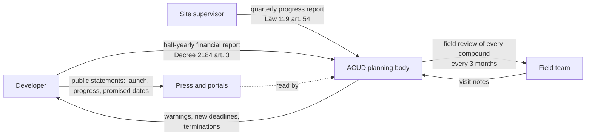

# Current state (as-is): how R7 compounds are followed today

Bottom line: per public statements, every compound gets the same field review every 3 months, whatever its risk. Five of the six public late cases ran 18 to 33 months past their original promise (median 25). The evidence below points to three causes: effort is not matched to risk, progress is known mostly from the developer's own statements, and nobody compares pace with the promised date.

Sources: ACUD chairman statements (`docs/requirements/01-specs.md` section 12), Law 119/2008 article 54 and Decree 2184/2022 (`data/knowledge/external/`), and the real R7 tables of the current release (as of 2026Q3). ACUD's internal workflow was not observed. The map below is rebuilt from public sources and must be confirmed with ACUD.

## Process map (rebuilt from public sources)

| Step | Who | When | What we know | What we do not know |
| --- | --- | --- | --- | --- |
| Progress report | Site supervisor | Quarterly | Required by Law 119 art. 54 | Whether ACUD receives and checks them for R7; their content |
| Financial report | Developer | Half-yearly | Required by Decree 2184 art. 3 | Contents for R7 |
| Field review | ACUD field team | Every 3 months, every compound | Chairman statement | Visit length, team size, what is recorded |
| Public statements | Developer | Irregular | 0 to 3 published progress figures per compound; 5 of 12 have none | How ACUD uses them |
| Action | ACUD | After review | 6 mutual terminations across the city (chairman statement) | Thresholds and timing of warnings |

## Baseline in numbers (R7, 12 compounds, as of 2026Q3)

| Indicator | Value | Source |
| --- | --- | --- |
| Field reviews per year | 48 (12 compounds x 4) | `configs/cost_assumptions.yaml` |
| Public late cases with a known delay | 5 of 6; 18 to 33 months past the original promise, median 25 (C10 33, C12 28, C21 25, C19 19, C02 18); C14 not yet delivered | `real/eval_outcomes` |
| Compounds with months eligible for contract review (K5) | 7 of 12, 106 months in total (C18 45, C10 21, C21 14, C02 11, C14 9, C12 4, C19 2) | `real/kpi_values` K5 |
| Homes in those 7 compounds | 9,937 (published unit counts) | `real/compounds` |
| Priority level today | level 1: 1, level 2: 2, level 3: 3, level 4: 6 compounds | `real/kpi_values` |

## Root causes, with evidence

1. **Effort is not matched to risk** (if the public 3-month statement holds for R7). The 48 reviews are spread evenly: the 6 compounds at level 4 (routine) get the same 4 visits a year as C18, which is at level 1 with 45 months eligible for contract review (K5).
2. **Progress comes from the developer.** Public progress figures can run far ahead of the structure. C19 claimed 70% on 2022-09-21; that year 28% of its built area was 20 m or taller (Open Buildings Temporal). The two are different measures, so the gap is a reason to look, not proof. The supervisor reports that would settle it are not public.
3. **Nobody compares pace with the promised date.** C14 promised delivery by the end of 2024; on 2024-09-24, three months before that date, it reported 35% progress and moved the date to the end of 2026; on 2026-02-10 it reported 50% and moved it to the end of 2027. A site that keeps working passes a "is it active?" review every quarter while the promise slips. Three of the five missed backtest cases look like this (C14, C12, C19); in two more (C10, C02) the delay sat in finishing and handover (`data/experiments/35_backtest_diagnosis/DIAGNOSIS.md`).

## What the average hides

- **Activity.** The district mean activity score is 0.61, but it ranges from 0.03 (C12) to 0.90 (C04, C17); C12 and C03 are under half the mean. A district figure would call R7 "active" while two compounds show almost no activity (both flagged "may be complete"; C12 was handed over).
- **Developers.** The same developer can run one compound at level 1 and another at level 4: D14 has C18 at level 1 and C01 at level 4; D12 has C12 at level 3 and C04 and C10 at level 4. Judging by developer would hide both.
- **Delays.** A median delay of 25 months hides a range of 18 to 33 months, and a case (C14) that has no delay value because it is still not delivered.

The District view screen shows the activity spread, the developer groups and the delays from the same tables.

## Limits

- No ACUD records: no visit logs, visit times, warnings or supervisor reports. The process map and the 3-month cycle come from public sources and statements.
- Six public late cases are a small set; they show causes, not rates.
- Fine-eligible months are what the dates allow; the contract decides whether a fine applies.
