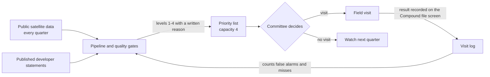

# Target state (to-be): the priority list sets the order, the committee decides

Status: proposed by the team, not approved by ACUD. Every target below is a proposal for the committee to change. The baseline column uses the same indicators as `docs/deliverables/as-is.md` (R7, 12 compounds, as of 2026Q3).

## The new process

| Step                                                                                   | Who (role)                                      | When                          |
| -------------------------------------------------------------------------------------- | ----------------------------------------------- | ----------------------------- |
| Run the pipeline, check the quality gates, publish the list                            | Track A owner, reviewed by a second team member | Every quarter                 |
| Decide which compounds to visit and what action follows                                | Committee                                       | Every quarter, after the list |
| Visit and record the result (`progressing`, `stalled`, `complete`, `not done`) | Field visit lead                                | Within the quarter            |
| Keep the code-to-name mapping and any ACUD data                                        | ACUD data custodian                             | Ongoing                       |

The system recommends; the committee decides. How the roles are filled and when this starts are in `docs/deliverables/transition-plan.md`.

## Targets (proposed) on the same indicators

| Indicator                                                                                                                                     | Baseline (2026Q3)                                                                                                                       | Target, normal conditions                                                                                                | Why this target                                                                                                                                                                                                                                                                         |
| --------------------------------------------------------------------------------------------------------------------------------------------- | --------------------------------------------------------------------------------------------------------------------------------------- | ------------------------------------------------------------------------------------------------------------------------ | --------------------------------------------------------------------------------------------------------------------------------------------------------------------------------------------------------------------------------------------------------------------------------------- |
| Compounds at level 1 or 2 visited within the quarter                                                                                          | not recorded (no ACUD visit log)                                                                                                        | all of them; the list has room for 4                                                                                     | In all 31 quarters from 2019Q1 to 2026Q3 at most 4 compounds were at level 1 or 2 at once (2025Q3, 2025Q4 and 2026Q1), so a capacity of 4 covered every one.                                                                                                                            |
| Visit results recorded                                                                                                                        | not recorded                                                                                                                            | 12 of 12 in the pilot quarter, then every visit                                                                          | Needed to count false alarms and misses on real visits; the backtest cannot, since all six of its cases were late.                                                                                                                                                                      |
| Assessable compounds (K4)                                                                                                                     | 12 of 12; all 372 compound-quarters since 2019Q1                                                                                        | 12 of 12 every quarter                                                                                                   | Already met; the target is to keep it.                                                                                                                                                                                                                                                  |
| Stall count (K2) on started compounds not flagged "may be complete"                                                                           | 1 or more in 1 compound (C07, K2 = 2); C03, C12 and C21 also show K2 of 1 or more but may be complete, so the rule caps them at level 3 | at most 1 quarter                                                                                                        | 2 quarters is the level-2 threshold in `configs/data.yaml` (`k2_l2`); a single quarter only asks for a document review. A finished site keeps counting, so it is left out.                                                                                                          |
| Handover clock (K3)                                                                                                                           | above 0 in 2 compounds (C14, C18)                                                                                                       | 0 as the aim; every compound above 0 is reviewed by the committee in the same cycle, and above 12 months it is escalated | K3 counts months past the first announced handover date, so above 0 means buyers are already waiting. 12 months is the grace in Decree 2184/2022 art. 5, counted there from the contract date. The committee cannot bring K3 to 0 by itself; it can make sure no case waits unreviewed. |
| Months eligible for contract review (K5, a screening count, not a fine) reviewed by the committee                                             | 7 compounds, 106 months, review status not recorded                                                                                     | every compound with K5 above 0 reviewed within one cycle                                                                 | The contract decides whether a fine applies; the target is that none waits unreviewed.                                                                                                                                                                                                  |
| No-start clock (K6)                                                                                                                           | 0 compounds above 0                                                                                                                     | 0                                                                                                                        | Already met.                                                                                                                                                                                                                                                                            |
| Public late cases flagged at least 6 months before the first delivery date (the backtest's reading of the criterion fixed on 26 October 2026) | 1 of 6                                                                                                                                  | 5 cases (the bar was 5 of 8 when eight cases were in scope; it stays 5 with six, and is not lowered)                     | Not met. The five misses were active-but-slow sites and finishing delays (`data/experiments/35_backtest_diagnosis/DIAGNOSIS.md`); reaching the bar needs a pace-against-promise indicator that is untested.                                                                           |

The activity score A has no target of its own: it is an input. Its targets are its acceptance tests in `configs/data.yaml` (`activity`): at least 3 points of balanced accuracy over K1, no more than 5 points of extra false alarms, and at most 10 points of seasonal spread.

## Normal and extreme conditions

| Condition                                                             | What the data shows                                                                                                          | What the target becomes                                                                                                                                                                  |
| --------------------------------------------------------------------- | ---------------------------------------------------------------------------------------------------------------------------- | ---------------------------------------------------------------------------------------------------------------------------------------------------------------------------------------- |
| Normal: quarterly public imagery, at most 4 compounds at level 1 or 2 | 31 of 31 quarters                                                                                                            | The targets above.                                                                                                                                                                       |
| More compounds at level 1 or 2 than the list holds                    | Re-ranking the real levels (S3): with 2 places C03 and C14 drop off the 2026Q3 list; with 6 places C12 and C21 join          | The committee raises capacity for that quarter or accepts that the lowest-ranked wait one quarter; the decision is recorded.                                                             |
| Cost or collection shock (generated)                                  | S1 (USD/EGP +30%) and S2 (collections -25% for six months) move no compound's level or list place in any month up to 2026-09 | No change to the targets. This shows the list rests on satellite and date signals; it is not evidence that the list is robust to real finance shocks, which the system does not observe. |
| Imagery missing or activity score failing                             | Not seen since 2019 (K4 met in all 372 compound-quarters)                                                                    | Missing quarters are "not assessable" and never raise a level; if A fails its tests, the rule falls back to K1 (`source: k1`).                                                         |

Scenarios S1 and S2 use generated finance data (Track B); S3 re-ranks the real Track A levels.

## Reference standards

| Our indicator                               | ISO 37120 / ISO 37122                                                                                                                                                              | U4SSC                                                                                                                                                                            |
| ------------------------------------------- | ---------------------------------------------------------------------------------------------------------------------------------------------------------------------------------- | -------------------------------------------------------------------------------------------------------------------------------------------------------------------------------- |
| K2, K3, K6, levels and the list             | Closest theme: urban planning in ISO 37122. None of the indicators in the public abstracts we read measures project-level construction progress; the full standards were not read. | The U4SSC set (91 indicators on ITU-T Y.4903, economy, environment, and society and culture dimensions) was checked at framework level only; no matching indicator was verified. |
| Building permits (on the ACUD data request) | ISO 37122 urban-planning indicators: average time for building-permit approval (days) and the share of permits submitted electronically                                            | not checked                                                                                                                                                                      |

The standards define indicators; they do not set targets for a district. The targets above are justified by R7 data and the thresholds fixed in `configs/data.yaml`, not by the standards. Sources: `chatbot/knowledge/external/iso-37120-37122-city-indicators-en.md` (public abstracts) and the [ITU U4SSC KPI page](https://www.itu.int/en/ITU-T/ssc/pages/kpis-on-ssc.aspx).

## Not covered

- Finishing, interior work and handover readiness: not visible from space.
- Developer finances: only generated data (Track B); no real collections or escrow balances.
- Legal decisions: fines, warnings and terminations stay with the committee and the contract.
- Districts other than R7: no other district has been run.
